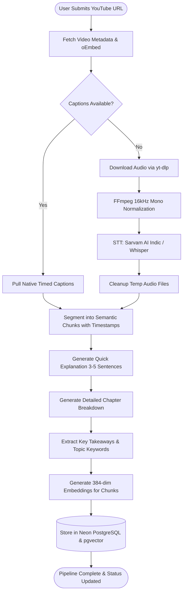

# AI Workflow & Orchestration Design

ExplainMe uses a **LangGraph StateGraph** pipeline coordinating speech-to-text models, large language models (**Mistral**), and dense vector embeddings (**SentenceTransformers / pgvector**) for video understanding and grounded conversational tutoring.

---

## 🧭 End-to-End Pipeline Workflow



---

## 🛠️ Step-by-Step Node Breakdown

### Node 1: `fetch_metadata`
- Validates YouTube URL.
- Queries YouTube oEmbed endpoint (with yt-dlp fallback) to extract title, author, duration, view count, and thumbnail.
- Updates `analysis_jobs` progress to 15%.

### Node 2: `retrieve_captions` (Fast Path)
- Queries `youtube-transcript-api` for existing manual or auto-generated captions in preferred languages (`en`, `hi`, `hi-Latn`).
- If present, extracts formatted transcript text and raw timestamped caption entries without downloading media.

### Node 3: `audio_fallback_stt` (Fallback Path)
- Triggered only when native captions are disabled or unavailable.
- Downloads audio track via `yt-dlp` into a sandboxed temporary directory.
- Converts audio to 16kHz mono WAV via FFmpeg.
- Dispatches to:
  - **`SarvamSTTProvider`**: For Hindi / Hinglish / Indic content.
  - **`WhisperSTTProvider`**: For English content using faster-whisper.
- Safely deletes temporary audio files upon completion.

### Node 4: `segment_transcript`
- Aggregates raw text fragments into semantic windows (target ~120 words per chunk).
- Preserves exact `start_time` and `end_time` boundaries on every chunk for RAG citation matching.

### Node 5: `generate_explanations`
- Calls **Mistral AI** (`mistral-small-latest`) via structured prompt templates:
  - **Quick Explanation:** 3–5 high-signal sentences answering: *What is this video about? What is its core premise? Why does it matter?*
  - **Detailed Breakdown:** Structured lessons, chapter headings, and key concept breakdowns in Markdown.

### Node 6: `extract_insights`
- Extracts:
  - **Key Points (5–8):** Concrete insights mapped to timestamp markers.
  - **Keywords (8–12):** Filtered topic tags with relevance scores and categories (`Concept`, `Tool`, `Method`, `Domain`).

### Node 7: `create_embeddings`
- Generates dense 384-dimensional vector representations for all semantic transcript chunks.

### Node 8: `persist_results`
- Commits `Video`, `Transcript`, `TranscriptChunk` (with vectors), `Summary`, `KeyPoint`, and `Keyword` records into Neon PostgreSQL in an atomic database transaction.
- Sets `analysis_jobs.status = "completed"` and progress to 100%.

---

## 🤖 Grounded RAG & Anti-Hallucination Guard

When a user asks a question via `POST /api/v1/videos/{video_id}/ask`:

```text
User Question
      │
      ▼
Embedding Model (384-dim query vector)
      │
      ▼
pgvector Cosine Similarity Search (Strictly filtered by current video_id)
      │
      ▼
Top-4 Most Relevant Transcript Chunks (with timestamp ranges)
      │
      ▼
Strict Grounding Prompt to Mistral AI:
"Answer strictly based on the provided video transcript.
 If information is missing, reply: 'I couldn't find enough information in this video to answer that.'"
      │
      ▼
Structured Answer + Source Timestamp References
```

This guarantees:
1. **Zero Cross-Video Contamination:** Vector searches are isolated to the active video.
2. **Anti-Hallucination:** Answers are anchored strictly in spoken words.
3. **Citations:** Users receive clickable timestamps to verify answers against the video.
